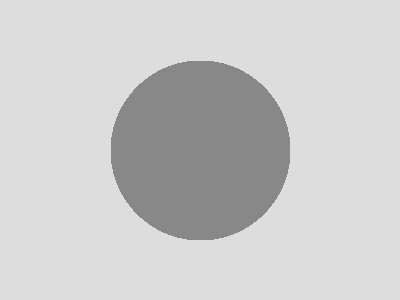

# Part one {.part-slide}

A part slide: in cjgg, the school blue behind it.

## Text and math

Body text, a [link](https://example.com), `inline code`, **bold** and *italic*.

Math with the sites' macros: $\Rb^n$, $\Norm{v}$, $\Gal{K/\Qb}$, and the sample's own $\Sample$. A display, numbered and cited as @eq-sample:

$$
\int_{\Rb} e^{-x^2} \dl{x} = \sqrt{\pi}
$$ {#eq-sample}

{width=60}

::: {.notes}
Speaker notes, with math: $\Abs{z} = 1$.
:::

## Blocks, by what they are for

:::: {.columns}
::: {.column width="50%"}
::: {.block-idea}
::: {.block-header}
Idea with $x^2$
:::
Text, with a [link](https://example.com).
:::

::: {.block-tip}
::: {.block-header}
Tip
:::
Text, with a [link](https://example.com).
:::
:::
::: {.column width="50%"}
::: {.block-method}
::: {.block-header}
Method
:::
Text, with a [link](https://example.com).
:::

::: {.block-caution}
::: {.block-header}
Caution
:::
Text, with a [link](https://example.com).
:::
:::
::::

## More blocks

:::: {.columns}
::: {.column width="50%"}
::: {.block-aside}
::: {.block-header}
Aside
:::
Text, with a [link](https://example.com).
:::

::: {.block-code}
::: {.block-header}
Code
:::
Text, with a [link](https://example.com).
:::
:::
::: {.column width="50%"}
::: {.block-reading}
#### Reading, with a heading for a header {.block-header}
Text, with a [link](https://example.com).
:::

::: {.block-school}
::: {.block-header}
School
:::
Text, with a [link](https://example.com).
:::
:::
::::

## Blocks by color only, and plain

:::: {.columns}
::: {.column width="33%"}
::: {.block-blue}
Blue, with a [link](https://example.com).
:::
::: {.block-pink}
Pink
:::
:::
::: {.column width="33%"}
::: {.block-yellow}
Yellow, with a [link](https://example.com).
:::
::: {.block-green}
Green
:::
:::
::: {.column width="33%"}
::: {.block-orange}
Orange, with a [link](https://example.com).
:::
::: {.block-plain}
Plain
:::
:::
::::

## Theorems

::: {#def-slide}
#### Hypersquare
A *hypersquare* is a square that has read too much.
:::

::: {#thm-slide}
#### Main theorem
Every hypersquare is a square: @def-slide.
:::

::: {.proof}
By inspection.
:::

## More environments

::: {#exr-slide}
Show that $\Abs{z}^2 = z \bar z$.
:::

::: {.solution collapse="true"}
Write $z = a + bi$.
:::

::: {.remark}
A remark.
:::

## Fragments

- Always there
- [Appears]{.fragment}
- [Appears, then steps back]{.fragment .fade-in-then-semi-out}

::: {.fragment .semi-fade-out}
A paragraph that steps back, with math $x^2$ and an image:

{width=80 fig-alt="A grey circle on a light square"}
:::

## The house look's own pieces

Words for the expert: an argument [(via the resolvent cubic)]{.expert-inline}.

::: {.expert-block}
An expert block.
:::

> A quotation, with a [link](https://example.com).

::: {.citation-block}
Author, *A source*, 2026 ([link](https://example.com)).
:::

## On a dark slide {background-color="#1e1e2e"}

Text, a [link](https://example.com), and the expert's words [(via the resolvent cubic)]{.expert-inline}.

::: {.block-idea}
::: {.block-header}
A block on a dark slide
:::
Text, with a [link](https://example.com).
:::

> A quotation, with a [link](https://example.com).

::: {.fragment .fade-in-then-semi-out}
Appears, then steps back.
:::

::: {.citation-block}
Author, *A source*, 2026 ([link](https://example.com)).
:::

## A media grid {.smaller}

::: {.media-grid}


:::

## An applet

<iframe data-src="applet.html" title="A sample applet: it shows the theme message the deck sends it" class="r-stretch"></iframe>

## A table and code

| $n$ | vertices | edges |
|:---:|:---:|:---:|
| 3 | 8 | 12 |
| 4 | 16 | 32 |

```python
print("a code block")
```

## Every macro {.scrollable .smaller}

```{=html}
<style>.macro-list ul { display: block; }</style>
```

::: {.macro-list style="column-count: 4; font-size: 0.6em"}
- `\SuchThat` ${\SuchThat}$
- `\Image` ${\Image}$
- `\Into` ${\Into}$
- `\Onto` ${\Onto}$
- `\Isomorphism` ${\Isomorphism}$
- `\Functions` ${\Functions}$
- `\Indicator` ${\Indicator{x}}$
- `\Ab` ${\Ab}$
- `\Bb` ${\Bb}$
- `\Cb` ${\Cb}$
- `\Db` ${\Db}$
- `\Eb` ${\Eb}$
- `\Fb` ${\Fb}$
- `\Gb` ${\Gb}$
- `\Hb` ${\Hb}$
- `\Ib` ${\Ib}$
- `\Jb` ${\Jb}$
- `\Kb` ${\Kb}$
- `\Lb` ${\Lb}$
- `\Mb` ${\Mb}$
- `\Nb` ${\Nb}$
- `\Ob` ${\Ob}$
- `\Pb` ${\Pb}$
- `\Qb` ${\Qb}$
- `\Rb` ${\Rb}$
- `\Sb` ${\Sb}$
- `\Tb` ${\Tb}$
- `\Ub` ${\Ub}$
- `\Vb` ${\Vb}$
- `\Wb` ${\Wb}$
- `\Xb` ${\Xb}$
- `\Yb` ${\Yb}$
- `\Zb` ${\Zb}$
- `\Pure` ${\Pure{x}}$
- `\Braid` ${\Braid{x}}$
- `\Symmetric` ${\Symmetric{x}}$
- `\Cyclic` ${\Cyclic{x}}$
- `\Modular` ${\Modular{x}}$
- `\Dihedral` ${\Dihedral{x}}$
- `\Alternating` ${\Alternating{x}}$
- `\Klein` ${\Klein}$
- `\Quaternion` ${\Quaternion[n]}$
- `\Affine` ${\Affine{x}{y}}$
- `\Permutation` ${\Permutation{x}}$
- `\ConjugacyClass` ${\ConjugacyClass[n]{x}}$
- `\Center` ${\Center{x}}$
- `\Normal` ${\Normal}$
- `\Acts` ${\Acts}$
- `\Fix` ${\Fix}$
- `\Stabilizer` ${\Stabilizer[n]{x}}$
- `\Orbit` ${\Orbit[n]{x}}$
- `\Centralizer` ${\Centralizer[n]{x}}$
- `\Abelianization` ${\Abelianization{x}}$
- `\Sign` ${\Sign}$
- `\Hom` ${\Hom}$
- `\End` ${\End}$
- `\Aut` ${\Aut}$
- `\Identity` ${\Identity}$
- `\Id` ${\Id}$
- `\Characteristic` ${\Characteristic}$
- `\Mat` ${\Mat}$
- `\Span` ${\Span}$
- `\Null` ${\Null}$
- `\Rank` ${\Rank}$
- `\Trace` ${\Trace}$
- `\Diagonal` ${\Diagonal}$
- `\GL` ${\GL}$
- `\SL` ${\SL}$
- `\Orthogonal` ${\Orthogonal}$
- `\SO` ${\SO}$
- `\Unitary` ${\Unitary}$
- `\SU` ${\SU}$
- `\PU` ${\PU}$
- `\PSL` ${\PSL}$
- `\PGL` ${\PGL}$
- `\PSU` ${\PSU}$
- `\I` ${\I}$
- `\SymmetricPower` ${\SymmetricPower[n]{x}}$
- `\ExteriorPower` ${\ExteriorPower[n]{x}}$
- `\ClassFunctions` ${\ClassFunctions{x}}$
- `\ContinuousFunctions` ${\ContinuousFunctions[n]}$
- `\IntegrableFunctions` ${\IntegrableFunctions[n]{x}}$
- `\Fourier` ${\Fourier}$
- `\Disc` ${\Disc{x}}$
- `\Res` ${\Res{x}{y}}$
- `\Gal` ${\Gal{x}}$
- `\RationalTo` ${\RationalTo}$
- `\Blowup` ${\Blowup{x}{y}}$
- `\Grassmannian` ${\Grassmannian{x}{y}}$
- `\Frob` ${\Frob{x}}$
- `\Poly` ${\Poly{x}{y}}$
- `\CatName` ${\CatName{x}}$
- `\VectorSpaces` ${\VectorSpaces{x}}$
- `\RD` ${\RD}$
- `\Abs` ${\Abs{x}}$
- `\Arg` ${\Arg{x}}$
- `\Vector` ${\Vector{x}}$
- `\Norm` ${\Norm{x}}$
- `\Iv` ${\Iv}$
- `\Jv` ${\Jv}$
- `\Kv` ${\Kv}$
- `\Comp` ${\Comp{x}{y}}$
- `\Proj` ${\Proj{x}{y}}$
- `\dl` ${\dl{x}}$
- `\diff` ${\diff{x}{y}}$
- `\diffp` ${\diffp{x}{y}}$
- `\difc` ${\difc{x}{y}}$
- `\difcp` ${\difcp{x}{y}}$
- `\Divergence` ${\Divergence}$
- `\Curl` ${\Curl}$
- `\Gradient` ${\Gradient}$
- `\D` ${\D}$
:::
