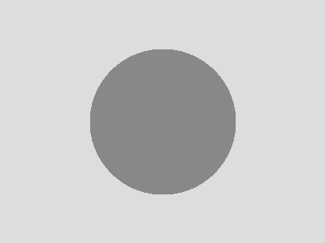

## Text

A [link](https://example.com), `inline code`, and math $\Rb$.

> A blockquote.

## Blocks

::: {.block-info}
::: {.block-header}
Block info with $x^2$
:::
Text in info, with a [link](https://example.com) and a [button](https://example.com){.btn}.
:::

::: {.block-code}
::: {.block-header}
Block code with $x^2$
:::
Text in code, with a [link](https://example.com) and a [button](https://example.com){.btn}.
:::

::: {.block-success}
::: {.block-header}
Block success with $x^2$
:::
Text in success, with a [link](https://example.com) and a [button](https://example.com){.btn}.
:::

::: {.block-attention}
::: {.block-header}
Block attention with $x^2$
:::
Text in attention, with a [link](https://example.com) and a [button](https://example.com){.btn}.
:::

::: {.block-warning}
::: {.block-header}
Block warning with $x^2$
:::
Text in warning, with a [link](https://example.com) and a [button](https://example.com){.btn}.
:::

::: {.block-danger}
::: {.block-header}
Block danger with $x^2$
:::
Text in danger, with a [link](https://example.com) and a [button](https://example.com){.btn}.
:::

::: {.block-note}
::: {.block-header}
Block note with $x^2$
:::
Text in note, with a [link](https://example.com) and a [button](https://example.com){.btn}.
:::

::: {.block-tip}
::: {.block-header}
Block tip with $x^2$
:::
Text in tip, with a [link](https://example.com) and a [button](https://example.com){.btn}.
:::

::: {.block-current}
::: {.block-header}
Block current with $x^2$
:::
Text in current, with a [link](https://example.com) and a [button](https://example.com){.btn}.
:::

::: {.block-scholar}
::: {.block-header}
Block scholar with $x^2$
:::
Text in scholar, with a [link](https://example.com) and a [button](https://example.com){.btn}.
:::

::: {.block-personal}
::: {.block-header}
Block personal with $x^2$
:::
Text in personal, with a [link](https://example.com) and a [button](https://example.com){.btn}.
:::

::: {.block-school}
::: {.block-header}
Block school with $x^2$
:::
Text in school, with a [link](https://example.com) and a [button](https://example.com){.btn}.
:::

## Theorems

::: {#def-sample}
#### Definition title
Statement of the definition.
:::

::: {#thm-sample}
#### Theorem title
Statement of the theorem.
:::

::: {#prp-sample}
#### Proposition title
Statement of the proposition.
:::

::: {#lem-sample}
#### Lemma title
Statement of the lemma.
:::

::: {#cor-sample}
#### Corollary title
Statement of the corollary.
:::

::: {#exr-sample}
#### Exercise title
Statement of the exercise.
:::

::: {.question}
A question div.
:::

::: {.counter-example}
A counter-example div.
:::

::: {.proof}
A proof div.
:::

::: {.remark}
A remark div.
:::

::: {.solution}
A solution div.
:::

::: {.proof .smile}
A proof .smile div.
:::

## Code

```python
print("a static code block")
```

```{=html}
<div class="cell">
<div class="code-with-filename"><div class="code-with-filename-file"><pre><strong>file.py</strong></pre></div>
<div class="sourceCode cell-code"><pre class="sourceCode python"><code class="sourceCode python">x = 1</code></pre></div></div>
<div class="cell-output cell-output-stdout"><pre><code>1</code></pre></div>
<div class="cell-output cell-output-error"><pre><code>NameError: y</code></pre></div>
<div class="cell-output-display"><a class="figure-link" href="#"><span class="figure-link-badge">Explore in 3D</span></a></div>
</div>
```

::: {.mock-cell}
```python
y
```

::: {.mock-error}
NameError: y
:::

::: {.mock-output}
42
:::
:::

## Figure

{fig-alt="A grey circle"}

## Diagram

```{mermaid}
flowchart LR
  A["solution"]:::solution --> B["contradiction"]:::contradiction --> C["engine"]:::engine
  C --> D["source"]:::source --> E["auxiliary"]:::auxiliary --> F["log"]:::log --> G["final"]:::final --> H["plain"]

```
